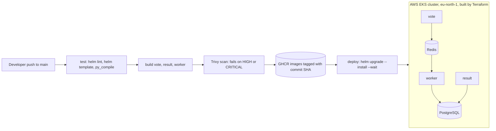
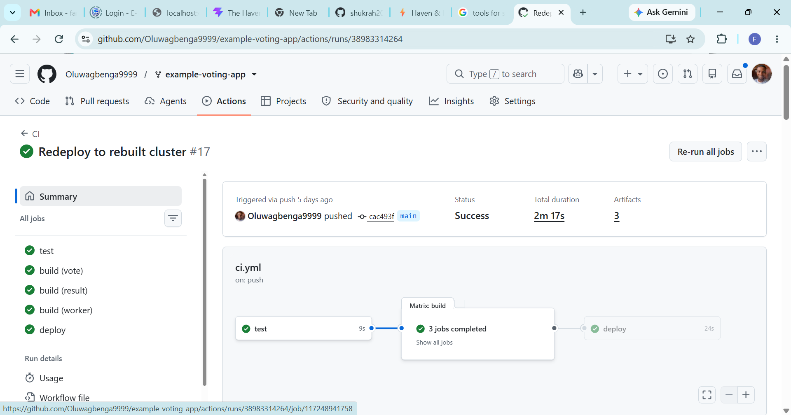
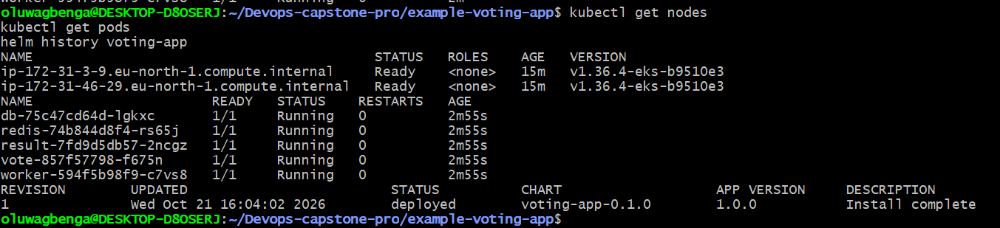

# Voting App: from code to automatic deployment (Capstone 1)

Forked from [dockersamples/example-voting-app](https://github.com/dockersamples/example-voting-app). A push to `main` tests, scans, builds and deploys the app to Kubernetes on AWS.

## Architecture



## What is in this repo

- `vote/`, `result/`, `worker/`: the three services, each with a pinned, non-root Dockerfile and a `.dockerignore`.
- `terraform/`: an EKS cluster and node group (2 x m7i-flex.large) in the default VPC.
- `helm/voting-app/`: one Helm chart with one `values.yaml`.
- `.github/workflows/ci.yml`: the pipeline.

## Pipeline

1. **test**: `helm lint`, `helm template` and a Python compile check.
2. **build**: each image is built, scanned by Trivy (HIGH and CRITICAL with a fix available fail the job), then pushed to GHCR tagged with the commit SHA.
3. **deploy**: `helm upgrade --install --wait` with the new SHA as the image tag.

The deploy job only runs when the repository variable `DEPLOY_ENABLED` is set to `true` (Settings → Secrets and variables → Actions → Variables). I keep it off while the EKS cluster is destroyed to avoid AWS charges, so pushes still run the tests, image builds and Trivy scan but skip the deploy.

## Secrets

No secrets are stored in Git. The AWS keys and the database password live in GitHub Actions secrets (`AWS_ACCESS_KEY_ID`, `AWS_SECRET_ACCESS_KEY`, `DB_PASSWORD`). The password reaches the cluster as a Kubernetes Secret created by the chart.

## Rebuild the environment from code

```
cd terraform
terraform init
terraform apply
aws eks update-kubeconfig --name voting-app --region eu-north-1
```

Then push to `main`, or run the `helm upgrade --install` command from the pipeline.

## Roll back a bad release

```
helm history voting-app
helm rollback voting-app <good-revision> --wait
```
Real output from a rollback I ran is in [`docs/rollback-evidence.txt`](docs/rollback-evidence.txt).
Helm records the rollback as a new revision, so the history is never lost.

## Screenshots

Green pipeline run (test, build, Trivy scan, deploy):



All pods running on the EKS cluster:

